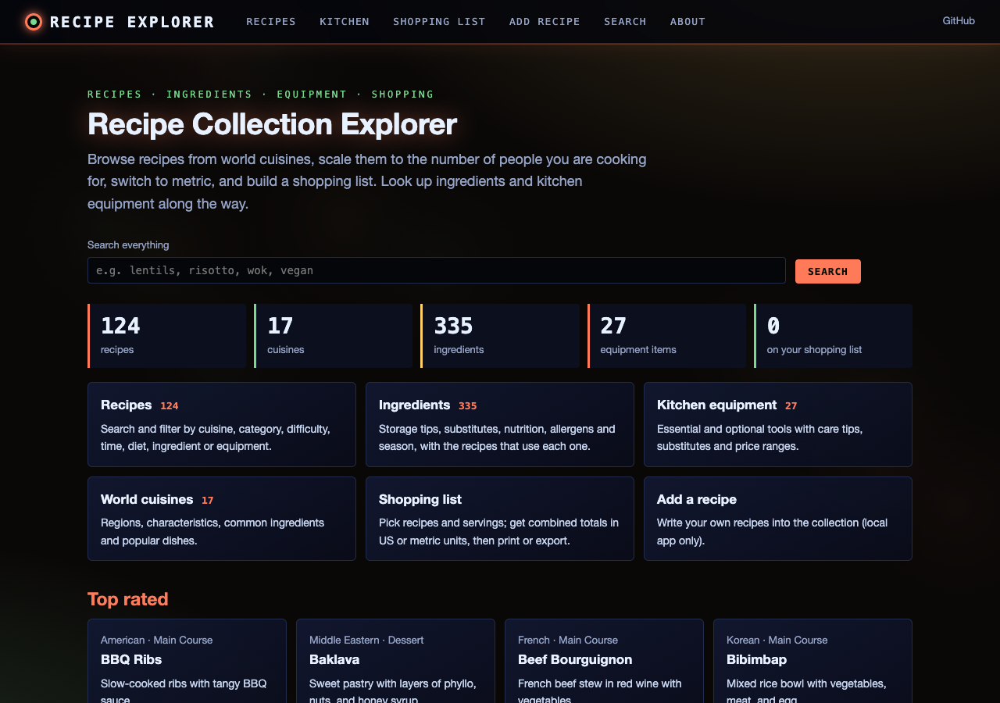
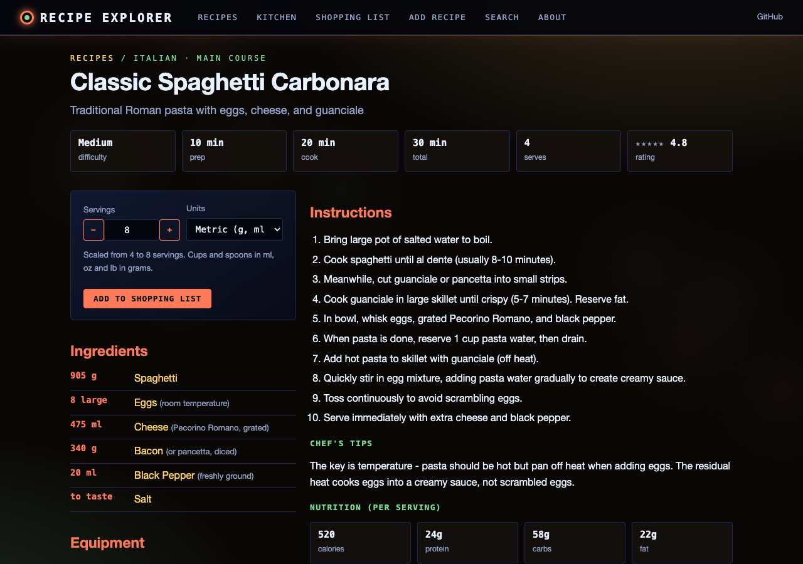
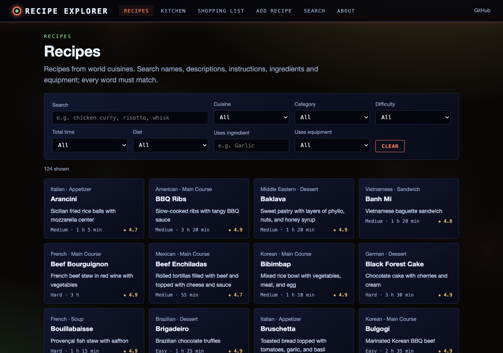
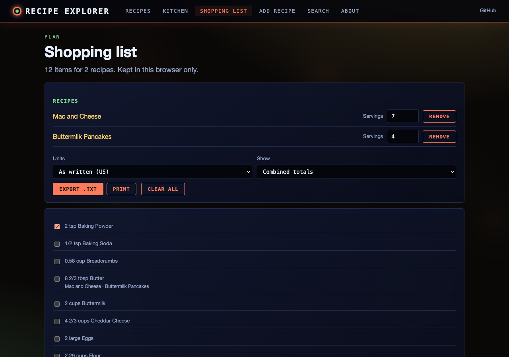

# Recipe Collection Explorer v1.0

A Python-based GUI application for managing recipes, ingredients, and kitchen equipment. Browse recipes from world cuisines, build shopping lists, and maintain your personal recipe collection.

## Features

### 1. **Recipes Browser**
- Browse recipes from 10+ world cuisines
- Search by name, description, or instructions
- Filter by:
  - Cuisine (Italian, French, Chinese, Japanese, Indian, Mexican, Thai, Greek, Spanish, Middle Eastern)
  - Category (Main Course, Appetizer, Dessert, Soup, Salad, Side Dish, Breakfast)
  - Difficulty (Easy, Medium, Hard)
  - Maximum cooking time
- View comprehensive recipe details:
  - Ingredients with quantities
  - Step-by-step instructions
  - Equipment needed
  - Prep and cook times
  - Nutritional information
  - Chef's tips
  - Dietary tags
  - Rating system (1-5 stars)
- Add recipes directly to shopping list
- Rate recipes
- Copy recipes to clipboard

### 2. **Ingredients Database**
- Browse 25+ common ingredients
- Search and filter by category:
  - Vegetables, Proteins, Grains, Dairy, Herbs, Spices, Oils
- View detailed ingredient information:
  - Descriptions and uses
  - Storage tips
  - Substitutes
  - Nutritional notes
  - Allergen information
  - Best season
- Add custom ingredients to database

### 3. **Equipment Reference**
- Browse 24+ kitchen equipment items
- Filter by category and essentialness
- Categories include:
  - Knives, Cookware, Bakeware, Prep Tools
  - Utensils, Measuring Tools, Appliances
- View equipment details:
  - Descriptions and uses
  - Substitutes
  - Care and maintenance tips
  - Price ranges
- Essential items marked with ⭐
- Add custom equipment

### 4. **World Cuisines Explorer**
- Learn about 10 major world cuisines
- View cuisine characteristics:
  - Regional origins
  - Common ingredients
  - Cooking techniques
  - Popular dishes
  - Recipes available in database

### 5. **Shopping List Generator**
- Add ingredients from recipes with one click
- Organized by recipe
- Export to text file
- Clear or modify list easily
- Checkbox format for easy shopping

### 6. **Add & Update Recipes**
- Add new recipes through user-friendly form
- Include all recipe details:
  - Basic info (name, cuisine, category)
  - Timing and servings
  - Ingredients (linked to ingredient database) when importing a recipe from text (File → Add New Recipe has no ingredient list)
  - Instructions
  - Tips and notes
- Update ratings after cooking
- Database automatically updates

### 7. **Export Functionality**
- Export all recipes to CSV
- Export shopping list to text file
- Import/backup capability

## Web interface and static site

The collection can also be browsed in a web browser, either as a local app (with adding, editing and rating) or as a
static site for GitHub Pages: https://gddickinson.github.io/recipe_explorer/ (once Pages is enabled).




- **Recipes**: search names, descriptions, instructions, ingredients and equipment; filter by cuisine, category,
  difficulty, total time, diet (vegetarian, vegan, gluten-free, dairy-free), ingredient or equipment.
- **Recipe pages**: scale to any number of servings and switch between the units as written and metric (cups and
  spoons to ml, ounces and pounds to grams), via `recipe_scaling.py`.
- **Shopping list**: add recipes at chosen servings; see combined totals or a list per recipe, tick items off, print
  or export as text (the desktop app's format). The list is kept in your browser only.
- **Ingredients, equipment and world cuisines**, each linked to the recipes that use them.
- **Add, edit and rate recipes** (local app only): saved to `recipe_collection.db`, the file the desktop app uses.




### Run the web app

```bash
pip install -r requirements-web.txt
python run_web.py                    # http://127.0.0.1:8115
python scripts/build_static.py       # static site in site/ (what GitHub Pages publishes)
python -m pytest -q tests/           # web, scaling/search parity and ingredient-link tests
```

Browsing opens the database read-only; only the add/edit/rate forms write to it. The static site exports every
recipe, ingredient, equipment item and cuisine as JSON and does search, scaling and the shopping list in the browser
with JavaScript ports of the Python rules (tests check both give identical results). Set `RECIPE_DB` to use another
database file.

## Installation & Requirements

### Requirements
- Python 3.7 or higher
- Required packages:
  - tkinter (usually included with Python)
  - sqlite3 (usually included with Python)

### Installation

1. **All files are included and ready to use - no additional packages needed beyond standard Python!**

2. **Files included:**
   - `recipe_database.py` - Database initialization script
   - `recipe_explorer.py` - Main GUI application
   - `recipe_collection.db` - SQLite database (auto-created)
   - `run_recipe_explorer.py` - Application launcher
   - `README.md` - This file
   - `db_operations.py` - Shared database helpers (`RecipeDAO`, ingredient lookup)

## Running the Application

### Option 1: Using the launcher (recommended)
```bash
python3 run_recipe_explorer.py
```

### Option 2: Direct execution
```bash
python3 recipe_explorer.py
```

### First Time Setup
If running for the first time and database doesn't exist:
```bash
python3 recipe_database.py
```

The application will:
1. Initialize the database if needed
2. Load all recipes, ingredients, and equipment
3. Open the GUI with multiple tabs

## Using the Application

### Recipes Tab
1. **Browse** recipes in the left panel
2. **Search** by name, description or instructions
3. **Filter** by cuisine, category, difficulty, or time
4. **Click** a recipe to see full details
5. **Actions:**
   - 🛒 Add ingredients to shopping list
   - 📋 Copy recipe to clipboard
   - ⭐ Rate the recipe (1-5 stars)

### Ingredients Tab
1. **Browse** all ingredients
2. **Search** by name
3. **Filter** by category
4. **Click** an ingredient for details
5. **Add** new ingredients with the + button

### Equipment Tab
1. **Browse** kitchen equipment
2. **Filter** by category or essentialness
3. **View** care tips and substitutes
4. **Add** new equipment items
5. ⭐ marks essential items

### Cuisines Tab
1. **Browse** world cuisines
2. **Learn** about characteristics and ingredients
3. **See** which recipes are available
4. **Explore** culinary traditions

### Shopping List Tab
1. **View** organized shopping list
2. **Export** to text file for printing
3. **Clear** when done shopping
4. Items grouped by recipe

## Database Structure

### Recipe Collection Database (recipe_collection.db)

#### Recipes Table
- Complete recipe information
- Timing and servings
- Instructions and tips
- Ratings and dietary tags

#### Ingredients Table
- Ingredient names and categories
- Storage and substitution information
- Nutritional and allergen data
- Seasonal availability

#### Equipment Table
- Equipment names and categories
- Essential vs. optional items
- Care tips and substitutes
- Price range guidance

#### Recipe-Ingredients Junction
- Links recipes to ingredients
- Quantities and units
- Special notes

#### Recipe-Equipment Junction
- Links recipes to required equipment
- Optional vs. required

#### Cuisines Table
- Cuisine characteristics
- Common ingredients
- Popular dishes
- Regional information

## Starter Recipes Included

A few examples (the database holds 124 recipes from 17 cuisines):

### Italian
- Classic Spaghetti Carbonara
- Margherita Pizza

### French
- Coq au Vin

### Chinese
- Kung Pao Chicken

### Japanese
- Chicken Teriyaki

### Indian
- Butter Chicken

### Mexican
- Chicken Tacos

### Thai
- Pad Thai

### American
- Classic Chocolate Chip Cookies

## Adding Your Own Recipes

### Via the GUI
1. Go to **File → Add New Recipe**
2. Fill in the form:
   - Required: Name, Cuisine, Category, Instructions
   - Optional: Description, Tips, Times
3. Click **Save Recipe**
4. Recipe appears in database immediately

### Via Database Script
Edit `recipe_database.py` and add to the `recipes_data` list, then run:
```bash
python3 recipe_database.py
```

## Customization

### Adding Ingredients
- Use the "+ Add Ingredient" button in the Ingredients tab
- Or add directly to the database

### Adding Equipment
- Use the "+ Add Equipment" button in the Equipment tab
- Mark items as essential if needed

### Adding Cuisines
Edit `recipe_database.py` and add to the `cuisines_data` list.

## Keyboard Shortcuts

- **Tab Navigation**: Ctrl+Tab (Windows/Linux) or Cmd+Tab (Mac)
- **Search Boxes**: Start typing to search immediately
- **Clear Search**: Click "Clear" button

## Tips for Best Use

### Recipe Organization
- Use consistent naming for easier searching
- Fill in all available fields for better reference
- Rate recipes after trying them

### Shopping Lists
- Add recipes before shopping trip
- Export and print for convenience
- Clear list after shopping

### Ingredient Database
- Add substitutes you've tried
- Note seasonal availability
- Track allergen information

### Equipment Reference
- Mark items you own
- Use substitutes guide when needed
- Plan equipment purchases with price ranges

## Troubleshooting

### Database Issues
If you encounter database errors:
```bash
rm recipe_collection.db
python3 recipe_database.py
```

### Display Issues
- Ensure screen resolution is at least 1400x900
- Application is resizable
- All text boxes scroll if content is long

### Missing Data
- Run `python3 recipe_database.py` to repopulate
- Check that all files are in the same directory

## Technical Details

### Database: SQLite3
- Lightweight, file-based database
- No server required
- Fast queries
- Easy backup (copy .db file)

### GUI Framework: Tkinter
- Cross-platform (Windows, Mac, Linux)
- Native look and feel
- Included with Python

### Data Storage
- All data in `recipe_collection.db`
- JSON for complex fields (nutritional info)
- Easy to backup and share

## Database Statistics (recipe_collection.db)

- **Recipes**: 124 from 17 cuisines (54 from `recipe_database.py`, 70 more already in the committed database)
- **Ingredients**: 335 (31 with full details: storage, substitutes, nutrition, allergens, season)
- **Equipment**: 38 items (27 with full details, 11 added from the recipes' equipment lists)
- **Cuisines**: 17 world cuisines

## Future Enhancements

Potential improvements for future versions:
- Meal planning calendar
- Recipe scaling (adjust servings)
- Recipe import from websites
- Photo attachments
- Cooking timer integration
- Grocery store aisle organization
- Nutritional calculator
- Recipe sharing/export to PDF
- Ingredient inventory tracking
- Cost per serving calculator
- Recipe tags and collections
- Advanced search (by ingredient availability)

## Export/Backup Your Data

### Backup Database
Simply copy `recipe_collection.db` to safe location:
```bash
cp recipe_collection.db recipe_collection_backup.db
```

### Export Recipes
Use File → Export Recipes (CSV) to create spreadsheet

### Export Shopping List
Use the Export button in Shopping List tab

## Credits

**Starter Recipes**: Compiled from traditional recipes and culinary sources
**Application Development**: Built with Python, Tkinter, and SQLite

## License

Released under the [MIT licence](LICENSE).

Recipe data compiled from public domain traditional recipes and general culinary knowledge.

---

**Version**: 1.0  
**Last Updated**: January 2026

Enjoy cooking and exploring world cuisines! 🍳👨‍🍳👩‍🍳

## Quick Start Guide

1. **Run the application**: `python3 run_recipe_explorer.py`
2. **Browse recipes**: Click on Recipes tab, explore the recipes
3. **Try a recipe**: Click on "Chicken Teriyaki" or "Spaghetti Carbonara"
4. **Add to shopping list**: Click the 🛒 button
5. **View your list**: Go to Shopping List tab
6. **Add your own**: File → Add New Recipe

Happy cooking! 🍽️
